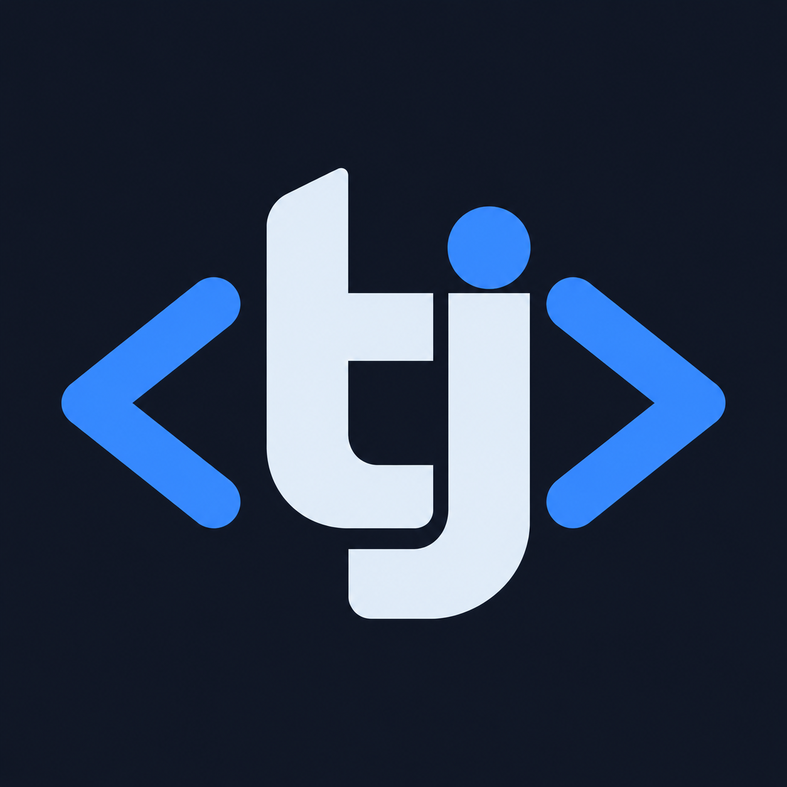

<p align="center"></p>

# tjstack

tjstack is a skill library for AI-assisted engineering in Claude Code and Cursor. It gives the agent playbooks for bug fixes, features, refactorings, and investigations, plus the skills those playbooks call: design before code, test-first builds, multi-agent fan-out, adversarial review, plain technical writing, and 28 engineering principles. The goal is less code, verified on the real artifact.

This repository is a plugin marketplace. The installable plugin is `tjstack/`.

## Documentation

- The [plugin README](tjstack/README.md) is the short tour: what tjstack does, how to start, and a sample prompt for each skill.
- The [tjstack guide](tjstack/docs/guide/README.md) is the tutorial. It follows one example project from setup through design, build, verification, and overnight runs, and ends with recipes and troubleshooting.
- The [skill reference](tjstack/docs/reference/skills.md), the [files reference](tjstack/docs/reference/files.md), and the [glossary](tjstack/docs/reference/glossary.md) are for lookups.
- In a chat, `/tjstack:tj-help <question>` answers from these pages and gives you a prompt to send. It starts no work.

## Install

**Claude Code.** Add the marketplace, then install the plugin:

```text
/plugin marketplace add thojou/tjstack
/plugin install tjstack@tjstack
```

Skills run as `/tjstack:<skill>`, for example `/tjstack:tj-mode`. To load a local checkout instead, run `claude --plugin-dir ./tjstack`.

**Cursor.** In Customize, add this repository as a local folder. Cursor reads `.cursor-plugin/marketplace.json` and the plugin's `.cursor-plugin/plugin.json`, then loads the skills and agents in `tjstack/`.

## Set up

Run `/tjstack:setup-tjstack` once after you install. It writes the rules the skills read:

- `tjstack-models` picks a model for each subagent role, at a reasoning budget you choose.
- `tjstack-pr-remote` names the git remote that pull requests go to. The default is `origin`.
- `tjstack-environment` says whether subagents run local or in the cloud. The default is `local`.
- `tjstack-harness`, outside Cursor only, translates the Cursor terms in the skills to the host's tools and paths.

Run `/tjstack:setup-source` before the first `why` question. It records which MCP servers answer each kind of evidence question.

## Use

Start with `/tjstack:tj-mode`. It matches the task to a playbook (Investigation, Bug fix, Perf issue, Feature, Refactoring, Prototype, and others) and calls the other skills at the step where each applies. You can also call any skill directly. The [guide](tjstack/docs/guide/02-tj-mode.md) explains how to write a prompt that routes well and how to read the reply.

Most skills set `disable-model-invocation: true`, so they load only when you or a playbook names them. `technical-writing`, `setup-source`, `setup-tjstack`, and `create-source-playbook` can also load on their own.

## Skills

Skills live in `tjstack/skills/<category>/<name>/SKILL.md`. The category only groups the files. The leaf directory is the skill name, so `skills/design/architect/` runs as `/tjstack:architect`.

### mode

How the agent works, and how to adapt that.

- [tj-mode](tjstack/skills/mode/tj-mode/SKILL.md) routes a task to a playbook and sets the reply, subagent, and autonomy rules.
- [customize-my-mode](tjstack/skills/mode/customize-my-mode/SKILL.md) drafts a personal `-mode` skill from your working conventions.

### orchestrate

Plan work and spread it across agents.

- [spawn-subagent](tjstack/skills/orchestrate/spawn-subagent/SKILL.md) sets the model, environment, and worktree before every subagent.
- [swarm](tjstack/skills/orchestrate/swarm/SKILL.md) fans out parallel workers and returns one report.
- [arena](tjstack/skills/orchestrate/arena/SKILL.md) runs competing attempts, picks a base, and grafts the best parts of the others into it.
- [figure-it-out](tjstack/skills/orchestrate/figure-it-out/SKILL.md) designs an auditable playbook when no bundled one fits.
- [peer-subagent](tjstack/skills/orchestrate/peer-subagent/SKILL.md) runs a brief on Codex CLI, Claude Code, or Cursor CLI.

### session

The running work: build, commit, track, and review the session.

- [tdd](tjstack/skills/session/tdd/SKILL.md) drives a change test-first with PHPUnit, red before green.
- [git-commit](tjstack/skills/session/git-commit/SKILL.md) stages by logical change and writes Conventional Commits.
- [track-your-work](tjstack/skills/session/track-your-work/SKILL.md) keeps a TSV decision trail for long or unattended runs.
- [catch-up](tjstack/skills/session/catch-up/SKILL.md) rebuilds your recent working context from chat history and the shared record.
- [retro](tjstack/skills/session/retro/SKILL.md) mines the session for durable learnings and proposes skill changes.

### design

Before code: clarify, record, and decide.

- [interview](tjstack/skills/design/interview/SKILL.md) sharpens an idea one question at a time and records the glossary.
- [create-prd](tjstack/skills/design/create-prd/SKILL.md) turns settled requirements into a PRD under `docs/prd/`.
- [create-adr](tjstack/skills/design/create-adr/SKILL.md) records one hard-to-reverse decision under `docs/adr/`.
- [architect](tjstack/skills/design/architect/SKILL.md) sketches types and module structure from competing designs before implementation.
- [prototype](tjstack/skills/design/prototype/SKILL.md) builds a throwaway that settles one design decision.

### understand

Understand code, history, and answers.

- [how](tjstack/skills/understand/how/SKILL.md) explains how a subsystem works and where code belongs.
- [why](tjstack/skills/understand/why/SKILL.md) investigates why code is shaped the way it is, across every configured evidence source.
- [code-explore](tjstack/skills/understand/code-explore/SKILL.md) is the source-control playbook that `why` reads.
- [explain](tjstack/skills/understand/explain/SKILL.md) combines `how` and `why` into one plain explanation.
- [teach](tjstack/skills/understand/teach/SKILL.md) teaches a topic over several sessions from a learning workspace.
- [rly](tjstack/skills/understand/rly/SKILL.md) restates the last answer in plain words.

### review

Check and clean up finished work.

- [challenge](tjstack/skills/review/challenge/SKILL.md) runs a multi-model adversarial review and gives a verdict.
- [blast-radius](tjstack/skills/review/blast-radius/SKILL.md) finds what a change breaks outside the diff and proves the safety fact.
- [clean-comments](tjstack/skills/review/clean-comments/SKILL.md) deletes comments the code can carry itself.
- [create-verification-skill](tjstack/skills/review/create-verification-skill/SKILL.md) writes a project `verify-*` skill that drives your app's browser or CLI.
- [audit](tjstack/skills/review/audit/SKILL.md) reviews a whole repository or folder and ranks bugs, risks, scale, missing tests, speed, and code to cut.

### writing

Text and documents for people.

- [technical-writing](tjstack/skills/writing/technical-writing/SKILL.md) is the standard for English and German docs, PR descriptions, and commit messages.
- [noslop](tjstack/skills/writing/noslop/SKILL.md) removes the patterns that make text read as model output.
- [md-to-pdf](tjstack/skills/writing/md-to-pdf/SKILL.md) renders Markdown to a print-ready PDF.

### principles

One skill per engineering rule. [tj-mode](tjstack/skills/mode/tj-mode/SKILL.md) lists each one with the situation it applies to.

- [principle-attack-the-premise](tjstack/skills/principles/principle-attack-the-premise/SKILL.md)
- [principle-boundary-discipline](tjstack/skills/principles/principle-boundary-discipline/SKILL.md)
- [principle-early-return](tjstack/skills/principles/principle-early-return/SKILL.md)
- [principle-build-the-lever](tjstack/skills/principles/principle-build-the-lever/SKILL.md)
- [principle-encode-lessons-in-structure](tjstack/skills/principles/principle-encode-lessons-in-structure/SKILL.md)
- [principle-exhaust-the-design-space](tjstack/skills/principles/principle-exhaust-the-design-space/SKILL.md)
- [principle-experience-first](tjstack/skills/principles/principle-experience-first/SKILL.md)
- [principle-explain-the-number](tjstack/skills/principles/principle-explain-the-number/SKILL.md)
- [principle-fail-fast](tjstack/skills/principles/principle-fail-fast/SKILL.md)
- [principle-fix-root-causes](tjstack/skills/principles/principle-fix-root-causes/SKILL.md)
- [principle-foundational-thinking](tjstack/skills/principles/principle-foundational-thinking/SKILL.md)
- [principle-functions-do-one-thing](tjstack/skills/principles/principle-functions-do-one-thing/SKILL.md)
- [principle-guard-the-context-window](tjstack/skills/principles/principle-guard-the-context-window/SKILL.md)
- [principle-laziness-protocol](tjstack/skills/principles/principle-laziness-protocol/SKILL.md)
- [principle-make-operations-idempotent](tjstack/skills/principles/principle-make-operations-idempotent/SKILL.md)
- [principle-migrate-callers-then-delete-legacy-apis](tjstack/skills/principles/principle-migrate-callers-then-delete-legacy-apis/SKILL.md)
- [principle-minimize-reader-load](tjstack/skills/principles/principle-minimize-reader-load/SKILL.md)
- [principle-model-the-domain](tjstack/skills/principles/principle-model-the-domain/SKILL.md)
- [principle-names-reveal-intent](tjstack/skills/principles/principle-names-reveal-intent/SKILL.md)
- [principle-never-block-on-the-human](tjstack/skills/principles/principle-never-block-on-the-human/SKILL.md)
- [principle-outcome-oriented-execution](tjstack/skills/principles/principle-outcome-oriented-execution/SKILL.md)
- [principle-prove-it-works](tjstack/skills/principles/principle-prove-it-works/SKILL.md)
- [principle-redesign-from-first-principles](tjstack/skills/principles/principle-redesign-from-first-principles/SKILL.md)
- [principle-separate-before-serializing-shared-state](tjstack/skills/principles/principle-separate-before-serializing-shared-state/SKILL.md)
- [principle-sequence-verifiable-units](tjstack/skills/principles/principle-sequence-verifiable-units/SKILL.md)
- [principle-subtract-before-you-add](tjstack/skills/principles/principle-subtract-before-you-add/SKILL.md)
- [principle-test-behavior-not-implementation](tjstack/skills/principles/principle-test-behavior-not-implementation/SKILL.md)
- [principle-type-system-discipline](tjstack/skills/principles/principle-type-system-discipline/SKILL.md)

### setup

Set up and extend tjstack.

- [setup-tjstack](tjstack/skills/setup/setup-tjstack/SKILL.md) writes the model, PR remote, environment, and harness rules.
- [setup-source](tjstack/skills/setup/setup-source/SKILL.md) configures the evidence sources that `why` reads.
- [create-source-playbook](tjstack/skills/setup/create-source-playbook/SKILL.md) writes an evidence playbook for one MCP server.
- [create-skill](tjstack/skills/setup/create-skill/SKILL.md) creates or revises a skill.
- [create-principle](tjstack/skills/setup/create-principle/SKILL.md) adds a principle in the form the others use.
- [tj-help](tjstack/skills/setup/tj-help/SKILL.md) answers questions about tjstack from the docs and hands back a prompt to send. It starts no work.

### Agents

- [tj-agent](tjstack/agents/tj-agent.md) is the subagent that works in tj-mode.
- [comment-cleaner](tjstack/agents/comment-cleaner.md) is the reviewer that `clean-comments` spawns.

## Session metrics

tjstack tracks each agent session through hooks in both hosts. One script, `tjstack/hooks/metrics.js`, handles both hosts and needs Node.js on `PATH`. It writes one JSON file per session to `~/.config/tjstack/metrics/` (or `$XDG_CONFIG_HOME/tjstack/metrics/`). After every turn, it rebuilds `board.html` in the same folder. Open that file in a browser to compare sessions across projects and hosts. No data leaves your machine.

| Metric | Claude Code | Cursor |
| --- | --- | --- |
| Agent time and turns | yes | yes |
| Tests (pass, fail, stale after an edit) | yes | yes, read from the output, because Cursor reports no exit code |
| Tokens and cost | yes, from the transcript at list prices | no, Cursor hooks do not report usage |
| Model and task name | yes | yes |

**Claude Code** also shows a band above the prompt. The band holds this session's cost, agent time and tests, plus the buttons tj-mode, Retro (`/tjstack:retro`), Board and Details. While tj-mode is on (`●`), every typed request runs with the `/tjstack:tj-mode` skill; slash commands run as typed. The choice is kept across sessions. Press ctrl+x, then Tab, to move the focus into the band from the keyboard. The band is a Claude Code hooks module (`tjstack/hooks/band/register.tsx`). Claude Code hooks modules are in early access.

**Cursor** gets the same hooks through `tjstack/hooks/cursor-hooks.json`, but no band, because Cursor has no UI extension point for it. The Cursor CLI in print mode (`agent -p`) sends no `beforeSubmitPrompt` or `stop` event. There, the `sessionEnd` hook takes the task name and the turn count from the transcript, and the agent time from the session's duration.

To rebuild the board by hand and open it, run `node tjstack/hooks/metrics.js board --open`. To run the tests, run `node --test tjstack/hooks/metrics.test.js`.

## Requirements

- Claude Code or Cursor.
- `git`. Pull request playbooks also need `gh` for GitHub or `glab` for GitLab.
- `python3` for `setup-tjstack` in Cursor and for `md-to-pdf`. `md-to-pdf` also needs the `markdown` and `beautifulsoup4` packages and Chrome or Chromium.
- `node` for the session-metrics hooks and for the plan check in the Multi-phase plan playbook.

## Contribute

To add a skill, follow the [create-skill](tjstack/skills/setup/create-skill/SKILL.md) skill. A new category also goes into `skills` in both `plugin.json` files, because neither host scans `skills/` more than one level deep. To add a principle, follow the [create-principle](tjstack/skills/setup/create-principle/SKILL.md) skill. Add every new skill to the list above, to the [skill reference](tjstack/docs/reference/skills.md), and to the guide page for its stage. If it changes which skill fits a question, update the routing tables in the `tj-help` skill too. Link skills by relative path, such as `../../skills/design/architect/SKILL.md`, so the link check covers them.

Run the checks before you open a pull request. CI runs the same commands.

```bash
python3 scripts/check-skills.py
node --test tjstack/skills/mode/tj-mode/scripts/check-plan.test.mjs
bash tjstack/skills/orchestrate/peer-subagent/scripts/spawn.test.sh
python3 tjstack/skills/setup/setup-tjstack/propose.py --self-check
node --test tjstack/hooks/metrics.test.js
```

`check-skills.py` checks that skill names are unique, that both manifests list every category, that descriptions parse, that every link resolves, that every skill a file cites exists in this plugin, and that this README and the tj-mode Principles index list every skill. It also checks every link in the plugin README and in `tjstack/docs/`, including links to headings.

## Credits

Adapted in part from [pstack](https://github.com/cursor/plugins/tree/main/pstack) by Lauren Tan, [skills](https://github.com/mattpocock/skills) by Matt Pocock, and [ponytail](https://github.com/DietrichGebert/ponytail) by DietrichGebert, all MIT. Their license texts are in [NOTICE](NOTICE). Several principles distill ideas from *Clean Code* by Robert C. Martin (Prentice Hall, 2008), restated in our own words.

## License

MIT. See [LICENSE](LICENSE).
