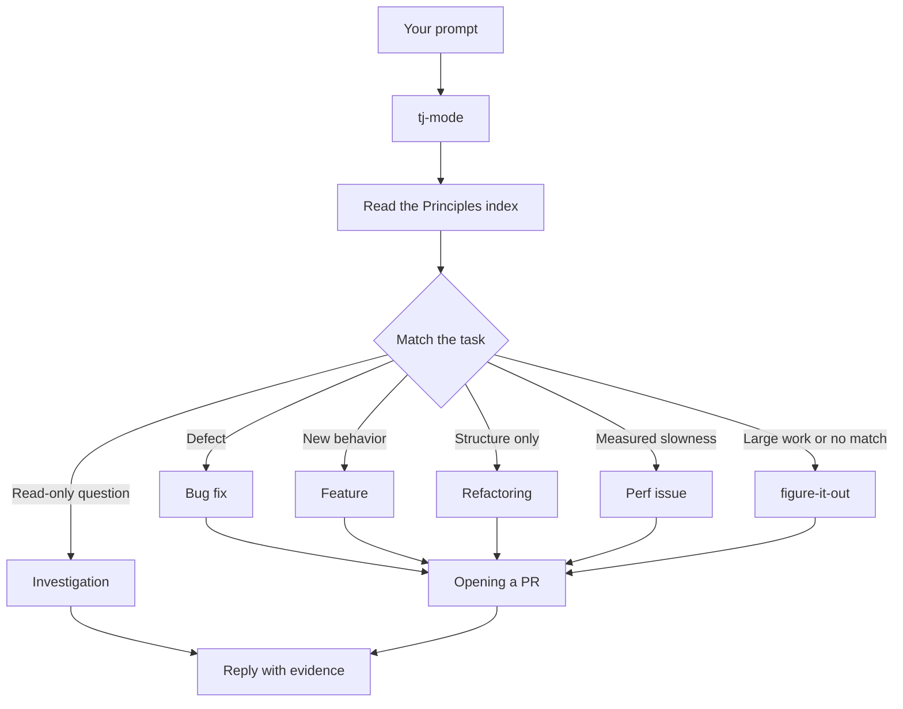

# Route work through `/tj-mode`

`/tj-mode` turns a request into a procedure. It reads your prompt, decides which kind of task it is, loads the playbook for that kind, and works through the steps, loading other skills when a step calls for them. This page explains the routing, what makes a prompt route well, where the agent acts on its own and where it stops, and how to audit its reply.

## What happens to your prompt



Before matching, tj-mode reads its index of principles, so the rules are in place before the first decision. Once it has matched a playbook, it loads that playbook together with every skill and principle the task needs in one call, with a small script (`scripts/load.mjs` in the tj-mode skill). The diagram covers the frequent routes. These are all thirteen playbooks:

| Playbook | Picked when | Ends in a PR |
| --- | --- | --- |
| [Investigation](../../skills/mode/tj-mode/playbooks/investigation.md) | You want an answer, not a change: how something works, why it exists, which option is better. | No |
| [Bug fix](../../skills/mode/tj-mode/playbooks/bug-fix.md) | Something behaves wrong and needs a reproduction, a root cause, and a fix. | Yes |
| [Perf issue](../../skills/mode/tj-mode/playbooks/perf-issue.md) | Something is measurably slow. | Yes |
| [Feature](../../skills/mode/tj-mode/playbooks/feature.md) | Behavior is new or changes. | Yes |
| [Refactoring](../../skills/mode/tj-mode/playbooks/refactoring.md) | Structure changes and behavior must stay identical. | Yes |
| [Prototype](../../skills/mode/tj-mode/playbooks/prototype.md) | A design or behavior question is cheaper to answer by building a throwaway than by arguing. | No |
| [Autonomous run](../../skills/mode/tj-mode/playbooks/autonomous-run.md) | The approach is known and the end state is checkable, so the agent can loop until it holds. | Yes |
| [Autopilot-stack](../../skills/mode/tj-mode/playbooks/autopilot-stack.md) | Several dependent PRs should be built and verified as one stack. | Yes |
| [Babysit](../../skills/mode/tj-mode/playbooks/babysit.md) | You ask for an open PR or stack to be brought to merge-ready. | Pushes fixes |
| [Session pickup](../../skills/mode/tj-mode/playbooks/session-pickup.md) | Work another agent started should continue from where it stopped. | No |
| [Pause safely](../../skills/mode/tj-mode/playbooks/pause-safely.md) | Running work must stop without losing anything. | No |
| [Multi-phase plan](../../skills/mode/tj-mode/playbooks/multi-phase-plan.md) | You want the plan for a multi-PR effort as the deliverable. | No |
| [Opening a PR](../../skills/mode/tj-mode/playbooks/opening-a-pr.md) | Any playbook that changed code has finished. | Yes |

If nothing in the table fits, or the job is big and its procedure still needs designing, tj-mode passes it to [`/figure-it-out`](../../skills/orchestrate/figure-it-out/SKILL.md). That skill writes a custom playbook before any code. [Page 7](./07-overnight.md) explains it.

A request to review a whole repository or folder ("audit this codebase", "what can I delete") goes to [`/audit`](../../skills/review/audit/SKILL.md). It reports and changes nothing. Each fix you pick from its report then runs as its own Bug fix, Refactoring, or Perf issue task.

## Name the outcome, skip the method

A routable prompt reads like a ticket, not like a recipe:

```text
/tj-mode customers on the yearly plan got two renewal invoices this morning. repro first, then fix and verify.
```

The agent recognizes a defect and loads Bug fix. "repro first" isn't a courtesy. It fixes the order of work, and the playbook enforces it. The todo list that follows starts with the Bug fix steps.

## What goes in a prompt

Think of five slots. Fill the ones you can, and each takes one sentence at most.

| Slot | What to write | Ledger example |
| --- | --- | --- |
| Outcome | The defect or the wanted behavior. | "credit notes ignore the customer's VAT exemption" |
| Check | Something that passes or fails. "Improve it" isn't one. | "INV-2207 shows 0% VAT and a total of 500.00" |
| Proof | The artifact you want to look at. | "paste the CLI output before and after" |
| Known facts | Anything that spares a search: ids, logs, links, steps. | "started after the tax-rules refactor, see PR 318" |
| Constraints | Instructions that change the procedure. | "no code changes yet", "behavior stays identical", "wait for my ok" |

All five together:

```text
/tj-mode credit notes ignore the customer's VAT exemption since PR 318. repro with customer C-77 first. done means INV-2207 shows 0% VAT and totals 500.00. paste the CLI output before and after.
```

Two things belong outside the prompt, at least at first:

- **The method.** If you prescribe the steps, you lose the chance that the agent finds a shorter route. Listing skills is the same mistake, see the pitfall at the end.
- **Your suspect.** Naming a cause points the search at it and away from everything else. Hold it back until the agent has written down its own reading of the problem.

That reading is worth asking for on purpose when the input is messy, such as a support thread or a vague ticket:

```text
/tj-mode here's the support thread about the dunning emails. tell me in two or three plain sentences what's actually going wrong. no code changes yet.
```

"no code changes yet" keeps this inside Investigation. If the agent misunderstood, you see it in three sentences and correct it with one reply, before any wrong fix exists.

When the idea itself is unclear, a restatement won't help, because there is nothing settled to restate. Start with [`/interview`](./04-design.md#sharpen-the-idea-with-interview). It asks questions one at a time until you and the agent mean the same thing by each word.

## Follow up short

Once a playbook is running, its steps carry the structure. Your follow-ups can be tiny:

```text
/tj-mode go ahead
```

```text
continue
```

```text
keep going until the check passes
```

The playbook remembers the order of work. You only add direction.

## Switch tasks with "new task"

In a long chat, the next question can look like the next step of the previous task. Mark the switch:

```text
/tj-mode new task. why does the pdf for INV-1042 still show the old company address? no code changes yet.
```

"new task" makes tj-mode match a playbook from scratch. "no code changes yet" makes that match Investigation. Leave both out, and a half-done Feature may absorb your question as one more Feature step.

## Keep parallel agents apart

Two agents editing one checkout will overwrite files, steal ports, and mix build output. The environment you picked in `/setup-tjstack` prevents that:

- **`local`.** Every subagent that writes gets a separate git worktree. Each worktree takes disk space, so a laptop handles a few at a time.
- **`cloud`.** Every subagent runs on its own cloud machine and branch. Claude Code uses the Agent tool's remote isolation where available and runs local otherwise.

To override the setting for one task, say so in the prompt, for example "run the subagents in the cloud" or "keep it all local". For your own work, ask for a worktree up front:

```text
/tj-mode new task. create a worktree from release/2.4 and backport the VAT exemption fix there.
```

Opening a PR always works in a worktree from main. Name a branch or path only when the default isn't what you want.

## Know what it does without asking

tj-mode acts without asking whenever the step can be undone. It runs commands, edits and commits, calls MCP tools, posts in team chat, updates tickets, and starts evals.

It stops and asks before anything that can't be undone:

- A force-push to a branch others use.
- A deploy.
- Deleting data.
- A message to a customer.
- Merging a PR, closing it, or turning on auto-merge.
- Any push or PR creation before the Destination tuple is printed. That block names the remote, URL, host, project, base, and head branch.

**Session overrides** such as "don't stop", "going to bed", "run until done", or "be fully autonomous" remove the routine check-ins. They don't touch the list above, and they don't change the PR remote. That stays `origin`, or the alias in the project's `.cursor/rules/tjstack-pr-remote.mdc`.

Questions about facts get answered by experiment, not by you. If the agent wonders whether a layout fits or a query is fast enough, it builds a quick sketch with the Prototype playbook and looks. You get asked about product and taste decisions, which no experiment can settle.

**"No" is a valid answer.** Ask tj-mode whether an idea is good and it tells you what it thinks, including that something isn't worth doing. Don't read silence or agreement as its default.

## Read the reply

Replies follow a fixed format, and that format gives you a checklist:

- **Principles tied to decisions.** Each principle the reply names should come with the concrete choice it changed. A name with no consequence attached means the rule was cited, not applied.
- **Every claim labeled.** Measured, inferred, or guessed. An untested prediction is a guess. An unlabeled confident claim deserves a follow-up question.
- **Who is affected, first.** The reply opens with what changes for the people who use the code, then what the next maintainer inherits.
- **The playbook's required content.** Each playbook defines what its reply must contain. A Bug fix reply, for example, shows the repro failing and then passing, lists the hypotheses it rejected, and says what would have caught the bug earlier.
- **Plain language.** Short sentences, no long dashes, no filler phrases, per the [`noslop`](../../skills/writing/noslop/SKILL.md) skill.
- **Skips and risks last.** The reply ends with one or two lines on what the agent left out or could not check, and why, plus any risk you need to know. A check it could have run doesn't count as a skip. Ask it to run that check.

Correct but unreadable? Type [`/rly`](../../skills/understand/rly/SKILL.md) and the agent restates its last message in everyday words.

## Leave it running

When you hand over a task and walk away, the finish line is the only thing that must be precise:

```text
/tj-mode i'm off for the day. move every caller from TaxCalculator to TaxEngine. stop when grep finds no TaxCalculator references and the suite is green. keep a decision log.
```

The approach is known and the end is checkable, so this goes to the Autonomous run playbook, which loops until the check passes. When the procedure itself still needs designing, the work goes to [`/figure-it-out`](../../skills/orchestrate/figure-it-out/SKILL.md) instead, which plans the phases first. Both record decisions with [`/track-your-work`](../../skills/session/track-your-work/SKILL.md). [Page 7](./07-overnight.md) covers the handover contract in full.

**Pitfall:** a prompt like "use /how, then /architect, then /arena" fights the playbook. The playbook already knows the order and the conditions for each skill, and a hand-written list tends to skip a step it needed. Reach for a skill by name only when you disagree with one particular choice the playbook would make.

The routing rules in full are in [`tj-mode`](../../skills/mode/tj-mode/SKILL.md).

**Try it.** Send a bug you know about with "repro first, then fix and verify". Put the resulting todo list next to the Bug fix playbook and look for `skip:` lines. For each one, ask yourself whether you'd have skipped that step too.

Next: [Understand Ledger's code first](./03-understand.md).
