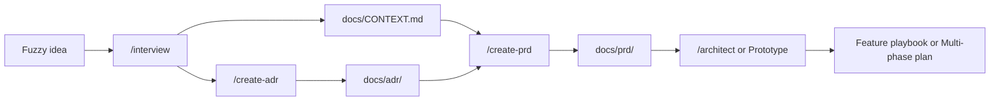
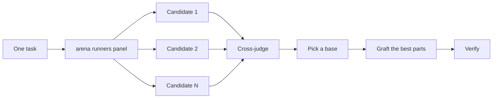

# Design before you write code

Ask a model for a design once and you get its first idea, presented with confidence. This page is about getting past that first idea cheaply. The tools split into two groups.

**What to build.** `/interview` pins down the idea and the words for it. `/create-adr` keeps a record of the decisions that would hurt to undo. `/create-prd` writes the agreed result down as requirements.

**How the code is shaped.** `/architect` fixes the types and boundaries. `/arena` gets several independent attempts and merges the strongest parts. `/swarm` runs parallel checks across slices. `/challenge` lets other models attack the result. The Prototype playbook settles questions by building a throwaway.

A plan comes last. Writing a detailed plan before any code has touched the problem means polishing guesses. Settle the open questions in code, then write down what's left.



Use only as much of the chain as the task needs. A typo fix needs none of it. Introducing "paused subscriptions" into Ledger, where "subscription", "plan", and "contract" already mean overlapping things, may need all of it.

## Sharpen the idea with `/interview`

```text
/interview customers should be able to pause a subscription for up to three months instead of cancelling.
```

[`/interview`](../../skills/design/interview/SKILL.md) works through the idea branch by branch until there's no disagreement left about what it means. It asks a single question at a time, proposes its own answer with it, and waits for yours. If the codebase can answer a question, it looks instead of asking. Your job is product and preference calls. Facts it can find, it finds.

What you get out of it is a shared vocabulary:

- **A glossary that grows during the session.** It writes to `docs/CONTEXT.md` by default, each term as soon as you agree on it.
- **Conflicts named on the spot.** If you use a term differently from the glossary, it shows you both definitions. If one word is doing two jobs, it suggests a separate name for each.
- **Edge cases as tests.** "If a paused subscription's card expires during the pause, what happens on resume?"
- **ADRs for real decisions**, offered only when a decision meets the bar below.

You can stop whenever you like. The reply lists the agreed terms and the open questions, and the open ones are parked under **Flagged ambiguities** in the glossary.

## Record a decision with `/create-adr`

```text
/create-adr paused subscriptions keep their original billing day when they resume.
```

[`/create-adr`](../../skills/design/create-adr/SKILL.md) produces one numbered file in `docs/adr/`. A script picks the number. The content states the decision and the reason, often in a single paragraph.

It refuses unless all three conditions hold, and says which one failed:

1. **Undoing it later costs real effort.**
2. **A future reader would be puzzled** by the code without the reason.
3. **There were real alternatives**, and this one won for a stated reason.

Decisions you can simply reverse don't get a record. An open decision gets `Status: proposed` along with the question that blocks it. A new ADR that replaces an older one links both ways.

## Write requirements with `/create-prd`

```text
/create-prd for the subscription pause.
```

[`/create-prd`](../../skills/design/create-prd/SKILL.md) assembles a requirements document at `docs/prd/NNNN-<feature>.md` from what's already settled: this conversation, the glossary, and the ADRs. It doesn't ask you anything new. If the idea isn't settled yet, that's `/interview`'s job.

It reads the affected code before writing and checks every statement about the current system. It also chooses **testing seams**, the places where the new behavior will be observed, preferring the highest level that can see it, like an HTTP endpoint, a console command, or a page. With you present, it shows the seam list once for confirmation. Without you, it marks the seams as unconfirmed.

The reply names what comes next: the Feature playbook for a single feature, Multi-phase plan for something that needs several PRs.

## Settle the shape with `/architect`

```text
/architect the pause and resume API for subscriptions. the callers are the billing cron and the customer portal. design from their side.
```

[`/architect`](../../skills/design/architect/SKILL.md) studies the ground first: `/how` over the code the design will touch, and `/why` if the design moves ownership between modules. Then it hands the brief to `/arena`, using the models on your `architect runners` line. Each candidate starts with how a caller would use the code, then derives types, signatures, and a module map, with bodies left as `not implemented`.

Two structurally different candidates are the minimum, even if the first one seems fine. Each is screened against a list of design red flags, asking one thing above all: if the next change is made by an agent that only opened one file and copied the nearest example, will that change still be right for the whole codebase? Among the survivors, the one with the smaller public surface wins.

Unless told otherwise, `/architect` moves from the chosen design straight into code. To review the design first:

```text
/architect with checkpoint. show me the design and wait.
```

Implementation can also overturn the design. Repeated workarounds in unrelated spots, or types that need `any` or casts to compile, count as evidence that the shape is wrong. `/architect` then throws the sketch away and designs again rather than patching.

## Fan out attempts with `/arena`

```text
/arena three candidates for the proration formula when a subscription resumes mid-cycle. compare them with what we have.
```

[`/arena`](../../skills/orchestrate/arena/SKILL.md) is the engine under `/architect`, and you can use it for any single artifact: a formula, a file format, a name, a function. It writes a rubric first. Then it sends the identical brief to several subagents, each with its own worktree or folder. A read-only judge scores every candidate against the rubric, on a different model family if your pool offers one. Finally the coordinator reads all candidates in full, chooses one as the base, adds the best ideas from the rest, and verifies the merged result.



The runner list comes from `/setup-tjstack`. Ask for more runners when getting it wrong is expensive:

```text
/arena five candidates for the invoice number format. it ends up on printed invoices and can't change later.
```

## Check many things at once with `/swarm`

```text
/swarm run the PDF renderer against every template in templates/invoices/. one worker per template, one combined report.
```

[`/swarm`](../../skills/orchestrate/swarm/SKILL.md) is for breadth. It either splits work into independent slices, or lets several workers race on the same brief, or combines both. A race declares its winning rule before it starts: `first pass`, `rank all`, or `best-of`. Each worker checks its own slice and reports `PASS`, `ISSUES`, or `BLOCKED` with evidence. You receive one compact report that also lists missing or failed workers.

The difference from `/arena`: `/arena` wants the best version of one thing and merges candidates. `/swarm` wants coverage and merges nothing.

## Break it with `/challenge`

```text
/challenge this branch. only report real bugs or behavior changes, no style remarks.
```

[`/challenge`](../../skills/review/challenge/SKILL.md) writes down in one paragraph what the change is supposed to do. Then it gives the same diff, intent, rubric, and code-quality checklist to every model on your `challenge reviewers` line. The value lies in the differences between models. Each one misses different things, so two models finding the same issue on their own is strong evidence.

Every finding must name a concrete case: this input or this situation leads to this wrong result. A finding without a case doesn't count. A performance finding also names the load it assumes, taken from the repository's README or deploy config, and the suggested fix is the smallest one that works.

The lead reviewer sorts every finding into one of four groups and gives a reason:

- **Act on.** Would block the PR in a real review.
- **Consider.** Valid, but maybe not worth fixing now.
- **Noted.** True, but nothing to do at this stage.
- **Dismissed.** Wrong, trivial, or based on missing context.

An **agreement map** closes the report, showing where the models agreed and where they split. Nothing gets applied automatically. Read the Dismissed group as well. The lead judges like an experienced engineer and can be wrong, and you can overrule it.

## Prototype instead of debating

When two options both sound reasonable, build both and look:

```text
/tj-mode prototype three layouts for the subscription pause dialog. screenshot each.
```

The [Prototype playbook](../../skills/mode/tj-mode/playbooks/prototype.md) hands off to the [`/prototype`](../../skills/design/prototype/SKILL.md) skill. That skill first names the single decision the sketch must settle, and then what kind of question it is, because the two kinds need different artifacts:

- **Appearance** (layout, interaction, density): around three variants that actually differ in structure or main action. A different color doesn't count. If a real page exists, the variants render inside it, behind one switcher with previous and next buttons, arrow-key navigation, and a `?variant=` parameter in the URL.
- **Logic** (behavior, timing, which approach works): the smallest script that answers it, or a single HTML file that displays the complete state after each step, with a few guided scenarios.

Before showing you anything, it operates every variant and captures screenshots or logs. The scratch code lives in `/tmp/prototype-<slug>/` and is never merged. The winning direction goes to the Feature playbook, which builds it properly.

For a bigger design, combine the two approaches and keep yourself in the loop:

```text
/tj-mode we need an approval step for invoices over 10,000 EUR. /architect it, settle open questions with prototypes, and wait for my review before building.
```

Keep adversarial review away from plans that have no code yet. Reviewers given only a plan imagine failure modes that never materialize, and you spend time defending against fiction. Let prototypes settle the uncertain parts, then send `/challenge` at the diff.

## Document a shared module before building it

When other code will depend on a new module, write its user documentation before the module:

```text
/tj-mode write the getting-started doc for the new tax rules module, as if it already existed. then /explain why that API is better than calling TaxCalculator directly.
```

A doc written first takes the caller's point of view, and the finished code can be checked against it. Name [`/technical-writing`](../../skills/writing/technical-writing/SKILL.md) when the doc has to be good, so a tutorial doesn't turn into half a reference manual.

## Plan after the design settles

Ask for the plan once there's a design to plan:

```text
/tj-mode plan the subscription pause rollout. one PR per verifiable step, each with its own proof.
```

The [Multi-phase plan playbook](../../skills/mode/tj-mode/playbooks/multi-phase-plan.md) declines to plan a change of one or two files with an obvious solution, and says so. Otherwise it resolves open questions by prototype, sends explorers to collect file paths and test commands, and fills a fixed template with one section per PR. Every section ends with how that PR proves it works, and a green suite alone isn't accepted as proof. A script, `scripts/check-plan.mjs`, then checks the plan, and the playbook fixes whatever the script reports. The output is the plan. It names the playbook that will execute it, and execution waits for your go.

For a migration, say what "the same" means:

```text
/tj-mode plan moving the invoice PDFs from the old template engine to Twig. one PR per template family, each compared pixel by pixel with today's output, existing quirks included.
```

"existing quirks included" stops the migration from fixing things along the way. Otherwise you can no longer compare old and new output.

## Match the design effort to the task

Less than this page might suggest. Most work goes straight to a playbook. As a guide:

- Familiar code, clear change: none. Go to the playbook.
- The team uses the same word for different things: `/interview`.
- A decision that is costly to undo and had alternatives: `/create-adr`.
- Requirements other people will build from: `/create-prd`.
- A finished small change you don't quite trust: `/challenge`.
- New code with several callers, or ownership moving between modules: `/architect`, which includes `/arena`.
- One isolated choice with several good answers: `/arena` alone.
- The same check across many items: `/swarm`.
- A question that running something would answer: a prototype.
- An expensive, disputed design: `/architect` now, `/challenge` before it ships.
- Several PRs: a plan, after the shape is clear.

tj-mode already applies part of this on its own. Code that crosses a function boundary triggers `/architect`, and a disputed design triggers `/challenge`. Calling these skills yourself is for when you want more scrutiny, or less, than tj-mode would choose.

**Try it.** Run `/interview` on something you plan to build, and stop after five questions. Then open `docs/CONTEXT.md` and compare each term with the word your team actually uses in standups.

Next: [Build, commit, and tidy the change](./05-build-and-clean.md).
