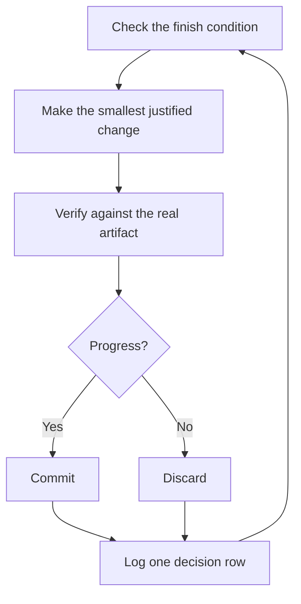

# Run work while you're away

Unattended runs are where the earlier pages pay off. An agent that can launch the app, check its result, and log its decisions can work for hours without you. An agent that can't will produce hours of plausible-looking changes you then have to untangle. This page covers when to trust a loop, how to hand one over, and how to review it afterward.

## Check the run is ready to be left alone

Go through this list before leaving an agent alone with a task:

- **You know what good looks like.** You've done the task yourself or watched an agent do it once.
- **It has your instruments.** The verify skill, the profiler, the logs, whatever you'd look at.
- **Each step can fail loudly.** A step that misses the bar stops the line instead of passing bad work on.
- **Known failure modes are fenced.** You've read a few transcripts and turned the repeat failures into checks or skills. [`/retro`](./09-make-it-yours.md#learn-from-a-session-with-retro) speeds that up.

If any item is missing, stay with the run and watch it.

## The overnight contract

The handover has four parts: what to do, how to know it's done, what's allowed, and when to give up. It fits in a short message:

```text
/tj-mode i'm going to bed. in a new worktree from main, replace every use of TaxCalculator with TaxEngine.
done when grep finds no TaxCalculator, the full suite passes, and TaxCalculator.php is deleted.
log your decisions. commit without asking me.
/loop until done. if nothing has moved for a few hours, stop and write down what's blocking.
```

What each part does:

| Part | Effect |
| --- | --- |
| "i'm going to bed" | A session override. The agent stops checking in. The [always-pause list](./02-tj-mode.md#know-what-it-does-without-asking) still holds. |
| "done when ..." | A condition every iteration can test. |
| "new worktree from main" | Keeps the run away from anything else you have open. |
| "commit without asking me" | Answers the one question that would otherwise block the run until morning. |
| `/loop` | The harness's loop feature, not part of tjstack. Cursor has it built in. Claude Code paces `/loop` itself when you give no interval. The [Autonomous run playbook](../../skills/mode/tj-mode/playbooks/autonomous-run.md) uses it to recheck the condition. |
| "stop and write down what's blocking" | An exit for a real dead end, so the agent doesn't spend the night redefining the goal. |

Merging is never part of "done". A run can open PRs and verify them, but the merge waits for you.

## Which path the run takes

Two paths exist for work you'll inspect later:

- **Autonomous run.** The method is known and the end state can be tested, so the playbook loops straight toward it.
- **[`/figure-it-out`](../../skills/orchestrate/figure-it-out/SKILL.md).** The job is large, spans many areas, or the procedure isn't obvious. It writes a tailored playbook first: a falsifiable definition of done, a size estimate, a rigor level that errs high, a verification harness with a recorded baseline before any change, and an order that tackles the riskiest unknown first. Then it works through that playbook as a series of experiments.

Both keep a decision trail with `/track-your-work`. For big runs, `/figure-it-out` usually commits the trail so it's part of the PR.

## One iteration of the loop



Each iteration makes one change, checks it, and writes one log row. A change that didn't move the condition gets reverted. When progress stalls, the agent changes approach rather than quitting, and it never loosens the condition to call it done.

Problems found along the way are fixed along the way: a broken skill, a flaky verifier, a neighboring bug. Each fix ships as its own PR through Opening a PR, then the run returns to the main task. You only hear about irreversible steps, product decisions no test can settle, and genuine dead ends.

## Stop a run on purpose

Say "pause", or mention that the laptop is about to close or the editor is about to restart. The [Pause safely playbook](../../skills/mode/tj-mode/playbooks/pause-safely.md) completes or rolls back the current step, commits a `wip:` checkpoint, and writes a resume note covering the goal, the progress, the next steps, and any traps. A new chat continues from that note with Session pickup. "Keep going" never counts as a pause request.

## The morning audit

The decision trail from [`/track-your-work`](../../skills/session/track-your-work/SKILL.md) is what you read in the morning. It's one TSV with one row per decision: time, phase, decision, reason, a pointer to the evidence (commit, `file:line`, screenshot), and outcome. It sits at `decisions.tsv` in the work directory, or at `.audit/<task-slug>.tsv` when several runs share a directory, and stays out of git unless a reviewer needs it.

Rows are never edited. A wrong decision is corrected by a new row that supersedes it. Before the run reports back, it compares its own rows with the transcript and adds any fork or change of course it forgot to log. Then a reviewer on a different model reads the trail and the transcript. The reply ends with an **Attention** section naming that model and the spots that need your eyes: thin evidence, verification claimed but not shown, decisions that look risky now.

Start with Attention, then follow its pointers into the log. That's a review of a dozen decisions, not of a night's transcript. In a terminal:

```bash
column -s$'\t' -t decisions.tsv
```

To see what else happened on the topic overnight, in other chats or in the shared record, run [`/catch-up`](./03-understand.md#return-to-a-topic-with-catch-up).

## Build a stack of dependent PRs with Autopilot-stack

Sometimes the job isn't one change but five that depend on each other. The [Autopilot-stack playbook](../../skills/mode/tj-mode/playbooks/autopilot-stack.md) handles that:

```text
/tj-mode autopilot these five tax-engine changes as one stack. don't land anything. i'll review it tomorrow.
```

How it's organized:

- **An owner per PR.** A fresh `tj-agent` builds each PR, opens it early, keeps its own decision trail, proves its change on the real surface, and runs Babysit in `drive` on it.
- **A root that audits.** Once you approve, your chat starts an hourly `/loop` and counts only real effects as progress: pushes, PR updates, pipeline runs. An owner that produces nothing for longer than its expected runtime counts as stuck and is replaced by a new agent with the full brief.
- **Verification on every final head.** For each owner's final commit, the root runs a swarm on another model: rerun the gates, prove the key behavior live, review the diff from several angles, and repeat the scenario on trunk to catch regressions. No live check, no clean verdict.
- **Stack, don't land.** A clean verdict adds the PR to a single linear stack. Only the root changes the stack's shape. Nobody merges, enables auto-merge, or closes a PR.

In the morning you have one stack, each link with a verdict, ready for you to review and land. tjstack has no autopilot that merges, and no long-running coordinator for multi-day programs. Independent changes run as separate Feature tasks. A program whose procedure still needs inventing goes to `/figure-it-out`.

Claude Code limits nesting: a subagent can't start its own subagents. The chat runs every fan-out, and delegates report back when they'd need one. Autopilot-stack still works there, but your chat carries more of the load. Long autopilot runs fit Cursor better, where each owner starts its own helpers.

## Hand a brief to another harness with `/peer-subagent`

Sometimes another tool has the model you want for one job. [`/peer-subagent`](../../skills/orchestrate/peer-subagent/SKILL.md) sends a standalone brief to the Codex CLI, Claude Code, or the Cursor CLI, much like an internal subagent:

```text
/peer-subagent have codex review the TaxEngine diff in read mode and return its findings.
```

You choose the harness, model, effort, `read` or `write` mode, and workspace. Write briefs get their own worktree first. The external agent sees nothing of your chat, so the brief has to include the goal, absolute paths, constraints, and the expected answer format. Every run starts fresh, and the script never adds a permission-bypass flag. Check the answer the way you'd check any subagent's work before relying on it.

**Pitfall:** giving a time budget instead of a finish line. "Work on it for four hours" means four hours of activity and no way to tell if it worked. `/loop` needs a condition that can fail.

**Try it.** For the next long task you have in mind, write the four parts of the contract. If you can't phrase "done when" as something a script could check, the task isn't ready to run unattended.

Next: [Steer with principle names](./08-principles.md).
